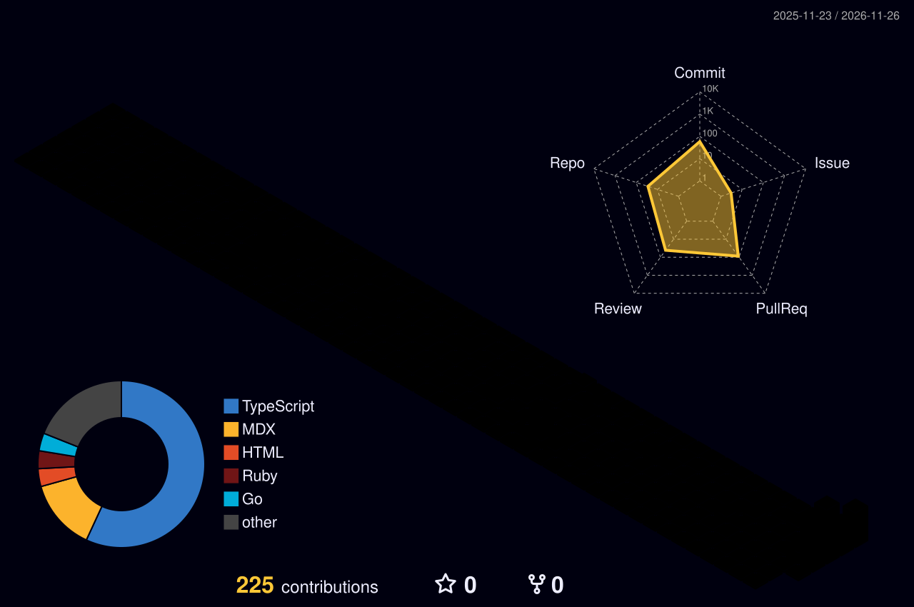

<!-- ═══════════════════════════ 3D HERO ═══════════════════════════ -->

  

  

<!-- ═══════════════════════════ NAV BAR ═══════════════════════════ -->

  
  
  
  
  
  

  
  
  
  

 

<!-- ═══════════════════════════ HERO / ABOUT ═══════════════════════════ -->

<table>
<tr>
<td width="58%" valign="top">

I'm a **Lead Developer at [Infosys](https://github.com/Infosys)** with **7+ years** of experience crafting web applications — and these days I spend most of my time building **Internal Developer Portals with [Backstage](https://backstage.io)**.

I love turning complex platform problems into clean, scalable, user‑friendly experiences, and I'm an active contributor to the **CNCF** ecosystem.

- 🔭 &nbsp;Leading **Backstage** platform engineering at Infosys
- 🧩 &nbsp;Contributing to **Backstage UI (BUI)**, docs & plugins
- 🌱 &nbsp;Exploring **cloud‑native**, **OpenTelemetry** & **policy‑as‑code**
- 👥 &nbsp;Leading teams to ship SPAs & full‑stack apps
- ✍️ &nbsp;Writing tech blogs on **[Dev.to](https://dev.to/ambrishramachandiran)**
- ⚡ &nbsp;*Fun fact: my code never crashes — it just takes a break* 😄

</td>
<td width="42%" align="center" valign="middle">
  
</td>
</tr>
</table>

<!-- ═══════════════════════════ IMPACT NUMBERS ═══════════════════════════ -->

  

### 🏆 Where I Contribute

<table>
<tr>
<td width="50%" valign="top">

####  &nbsp;[backstage/backstage](https://github.com/backstage/backstage/pulls?q=is%3Apr+author%3AAmbrishRamachandiran+is%3Amerged)
`77 merged PRs` · CNCF Incubating
 Backstage UI components, docs-ui, marketplace plugins and a large share of the official documentation.

</td>
<td width="50%" valign="top">

#### 🗂️ &nbsp;[cncf/gitdm](https://github.com/cncf/gitdm/pulls?q=is%3Apr+author%3AAmbrishRamachandiran+is%3Amerged)
`12 merged PRs` · CNCF
 Maintaining developer affiliations that power CNCF contribution analytics (DevStats).

</td>
</tr>
<tr>
<td width="50%" valign="top">

#### 🛡️ &nbsp;[kyverno/kyverno](https://github.com/kyverno/kyverno/pulls?q=is%3Apr+author%3AAmbrishRamachandiran+is%3Amerged)
`5 merged PRs` · CNCF Incubating
 README restructure for clarity & usability, documentation fixes and maintenance.

</td>
<td width="50%" valign="top">

#### 🔐 &nbsp;[Infosys/openfga-plugin-backstage](https://github.com/Infosys/openfga-plugin-backstage)
`Author` · Backstage Plugin
 Plugin wrapping the Backstage Permission Framework with <b>OpenFGA</b> for fine‑grained authorization.

</td>
</tr>
</table>

### ✨ Featured Contributions

| | Contribution | Project |
|:-:|:--|:--|
| 🎚️ | [**BUI — New Range Slider component**](https://github.com/backstage/backstage/pull/33112) | Backstage UI |
| 🔀 | [**More examples for the Switch component**](https://github.com/backstage/backstage/pull/34097) | Backstage UI |
| 🎨 | [**Migrate Apollo Explorer plugin from MUI to BUI**](https://github.com/backstage/community-plugins/pull/10062) | Community Plugins |
| 🗓️ | [**Holiday Tracker plugin on the Marketplace**](https://github.com/backstage/backstage/pull/30625) | Backstage |
| ⛅ | [**Daily Weather plugin on the Marketplace**](https://github.com/backstage/backstage/pull/29628) | Backstage |
| 📖 | [**Kyverno README — structure, clarity & usability**](https://github.com/kyverno/kyverno/pull/13569) | Kyverno |
| 🔐 | [**OpenFGA plugin for Backstage — initial release**](https://github.com/Infosys/openfga-plugin-backstage/pull/1) | Infosys |

  

<!-- ═══════════════════════════ TECH STACK ═══════════════════════════ -->

<table align="center">
<tr>
<td align="center" width="140"><b>Frontend</b></td>
<td>
  
</td>
</tr>
<tr>
<td align="center"><b>Backend & Data</b></td>
<td>
  
</td>
</tr>
<tr>
<td align="center"><b>Platform & Tools</b></td>
<td>
  
  &nbsp;
</td>
</tr>
</table>

<!-- ═══════════════════════════ ANALYTICS ═══════════════════════════ -->

  

  
  

  
  

  

<!-- ═══════════════════════════ CONNECT ═══════════════════════════ -->

  Whether it's developer portals, full‑stack apps, or open‑source tooling — 
  <b>I'm always up for a good collaboration.</b>

  
  
  
  

<!-- ═══════════════════════════ FOOTER ═══════════════════════════ -->

  

